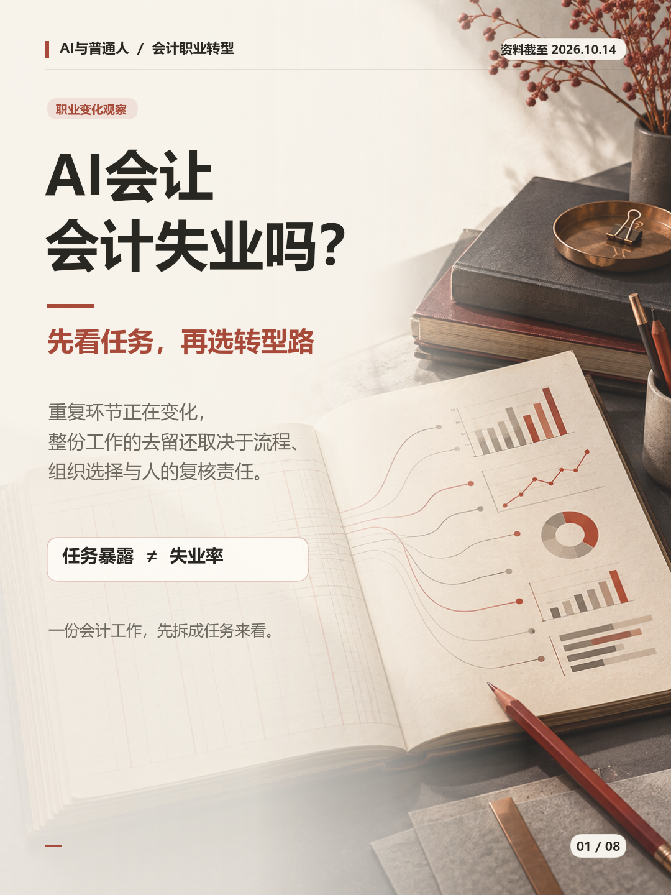
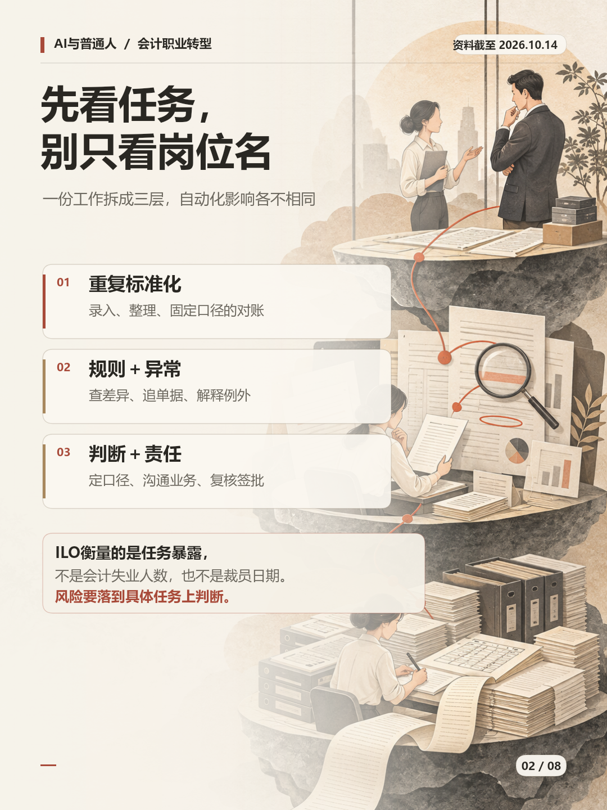
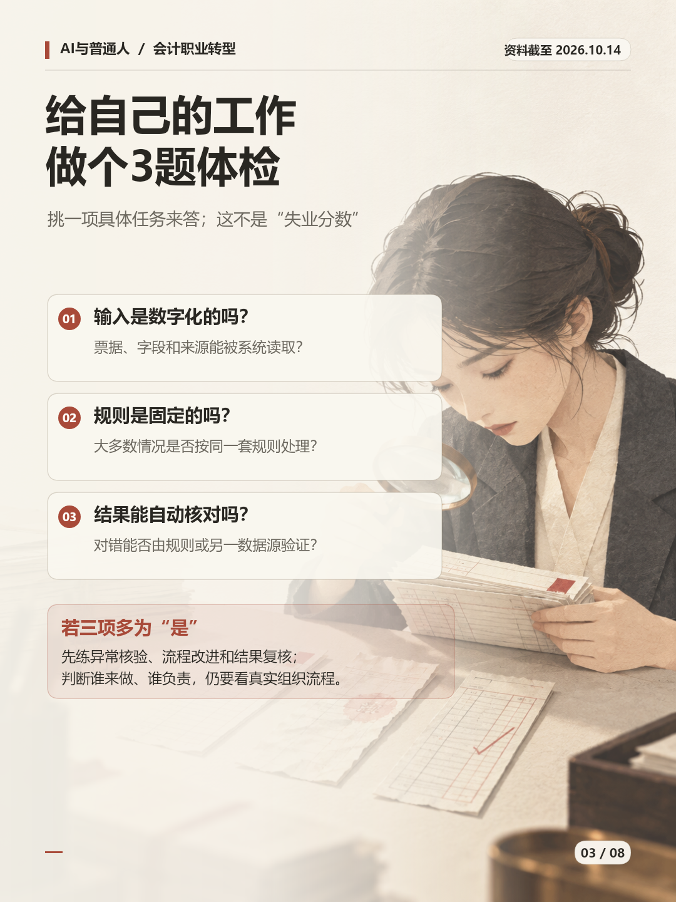
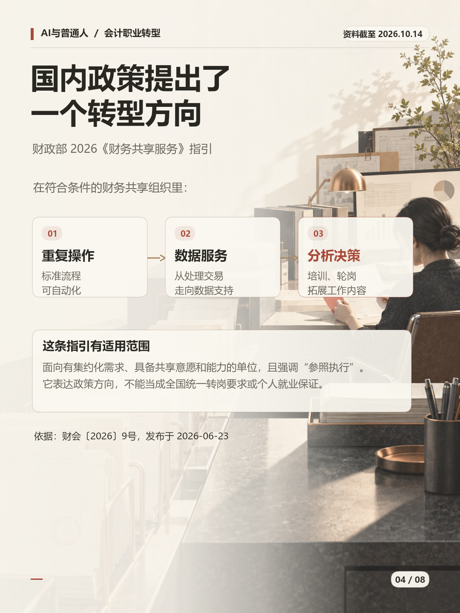
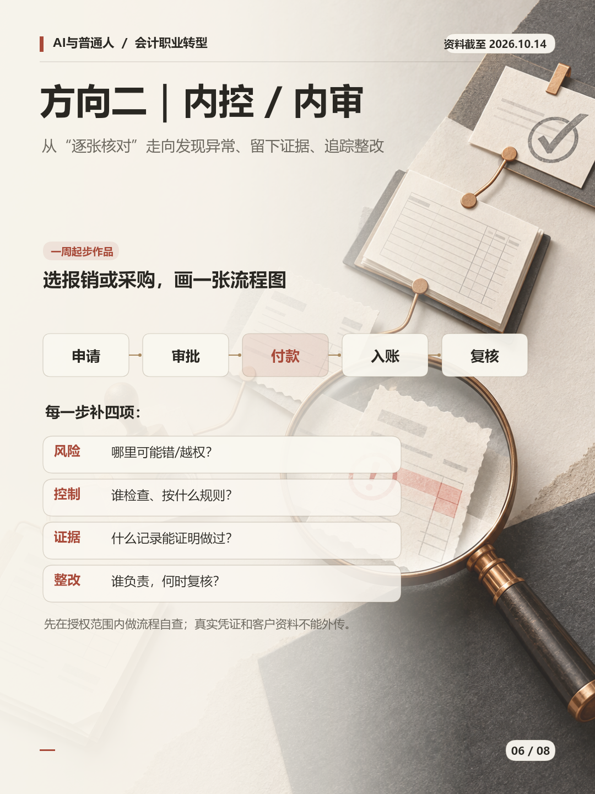
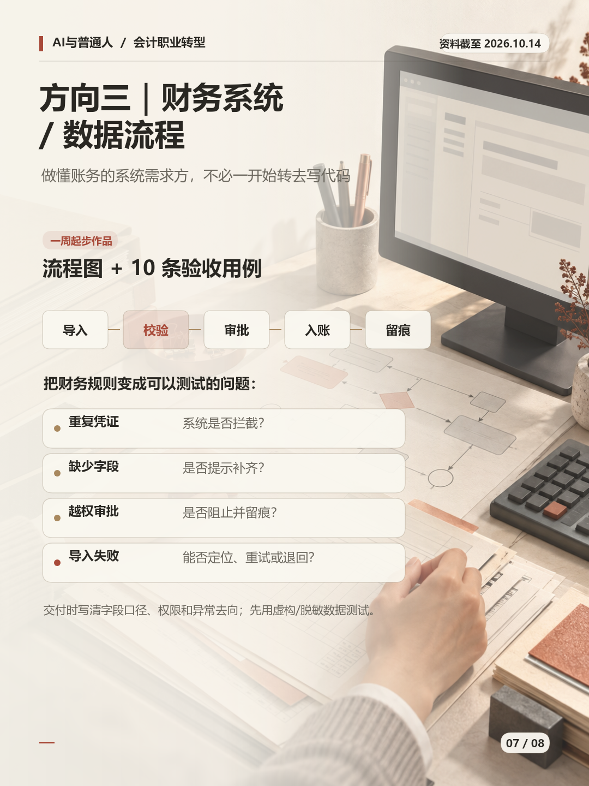
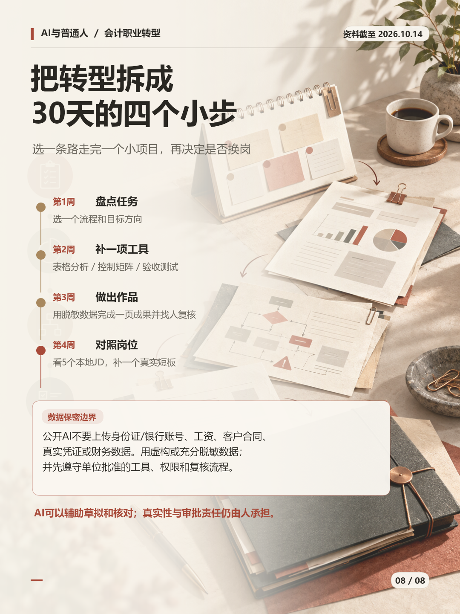

# AI会让会计失业吗？先看任务，再选转型路

资料截至：2026-10-14

## 图文图片（按顺序发布）

## 配文（复制发布）

AI会让会计失业吗？更准确的问题是：你每天做的哪些任务规则固定、重复度高、结果容易核对？ILO研究评估的是职业任务暴露，不是会计失业率；财政部2026年财务共享服务指引提出，在具备条件的组织里推动重复流程自动化，并通过培训和轮岗拓展分析决策工作。可以从三条相邻方向开始试：管理会计/FP&A、内控/内审、财务系统与数据流程。每条路都配了一份一周内能做出的作品，以及30天行动表。先用虚构或脱敏数据，别把真实凭证、工资、账号、客户合同贴进公开AI。完整长文见《会计AI转型长文》。#会计 #财务人 #AI时代 #职业转型 #职场成长

## 线索来源（不发布）

- [财政部《管理会计应用指引第804号——财务共享服务》](https://m.mof.gov.cn/zcfb/202606/t20260630_3992536.htm)，财会〔2026〕9号，发布于2026-06-23。议题线索：财务共享中心从交易处理向数据服务/管理支撑发展，以及重复操作岗位向分析决策拓展的政策方向。适用范围有限，内容未写成全国统一转岗要求。
- [ACCA中国《2026中国人才趋势调查》](https://www.accaglobal.com.cn/news/news/china-talent-trends-2026.html)，2026-05-27。议题线索：内地财会受访者的AI使用和岗位担忧同时存在；样本为1,712名财会专业人士，不是就业总体统计。
- [ACCA《Navigating ethics for trust》](https://www.accaglobal.com/policy-and-insights/reports/2026/navigating-ethics-for-trust.html)，2026-10-14。补充议题线索：AI使用中的核验、保密、监督与责任治理。

本议题依据上述政策和专业机构调查形成；具体事实核验回到下列官方/原始来源。图片为AI生成的概念插画，不是实际财务软件界面、官方文件截图或真实案例。

## 事实核验来源（不发布）

- [ILO《Generative AI and Jobs: A Refined Global Index of Occupational Exposure》](https://www.ilo.org/publications/generative-ai-and-jobs-refined-global-index-occupational-exposure)，2025-05-20：全球职业任务暴露研究、方法和梯度范围。
- [ILO研究者访谈：Generative AI at work](https://www.ilo.org/resource/article/generative-ai-work-what-it-means-jobs-europe-and-beyond)，2025-09-29：会计/簿记文员及任务暴露的解释；暴露不等于整份工作马上自动化。
- [财政部《管理会计应用指引第804号——财务共享服务》](https://m.mof.gov.cn/zcfb/202606/t20260630_3992536.htm)，2026-06-23：财务共享指引与适用边界。
- [财政部《关于全面深化管理会计应用的指导意见》](https://m.mof.gov.cn/zcfb/202412/t20241213_3949609.htm)，2024-12-13：全面预算、经营分析、数据治理和风险预警方向。
- [ACCA中国《2026中国人才趋势调查》](https://www.accaglobal.com.cn/news/news/china-talent-trends-2026.html)，2026-05-27：中国内地n=1,712；64%定期使用AI、55%担心岗位影响，均为受访者自述，不是失业率。
- [ACCA/CA ANZ《Bridging skills and data gaps for AI-enabled finance》](https://www.accaglobal.com/policy-and-insights/reports/2026/enabling-finance-insight.html)，2026-07-14：全球财务从业者关于数据质量、技能和系统整合障碍的研究。
- [IIA《Internal Auditing Competency Framework》](https://www.theiia.org/en/content/guidance/global/competency-framework/)，2025-07-10：内部审计能力框架。
- [财政部《会计信息化工作规范》通知](https://www.mof.gov.cn/jrttts/202408/t20240809_3941452.htm)，2024-08-07：会计信息化和数据质量、安全规范。
- [《中华人民共和国会计法》（2024年修正）](https://kjs.mof.gov.cn/zt/kjfxcgc/kjfqw/202408/t20240814_3941788.htm)，页面日期2024-08-14：单位负责人、会计机构及人员的真实性、完整性和监督责任。

## 长文

[打开《会计AI转型长文》](会计AI转型长文.md)
