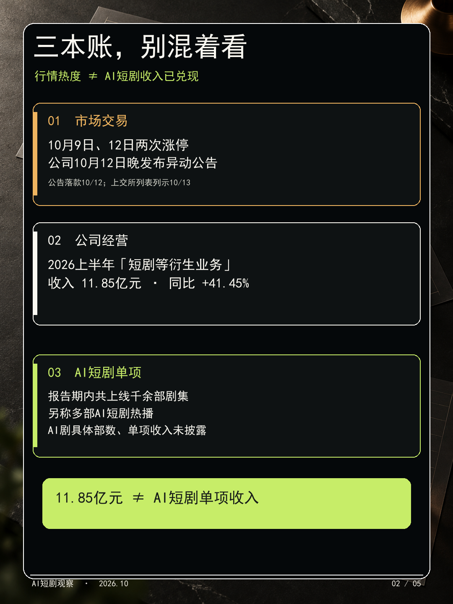
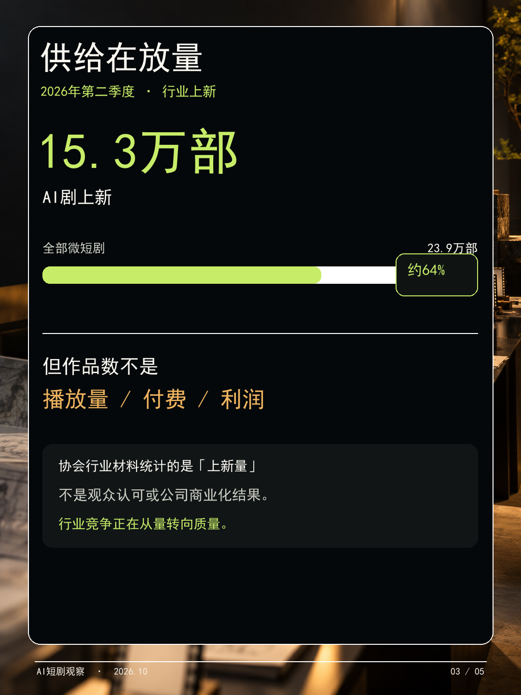
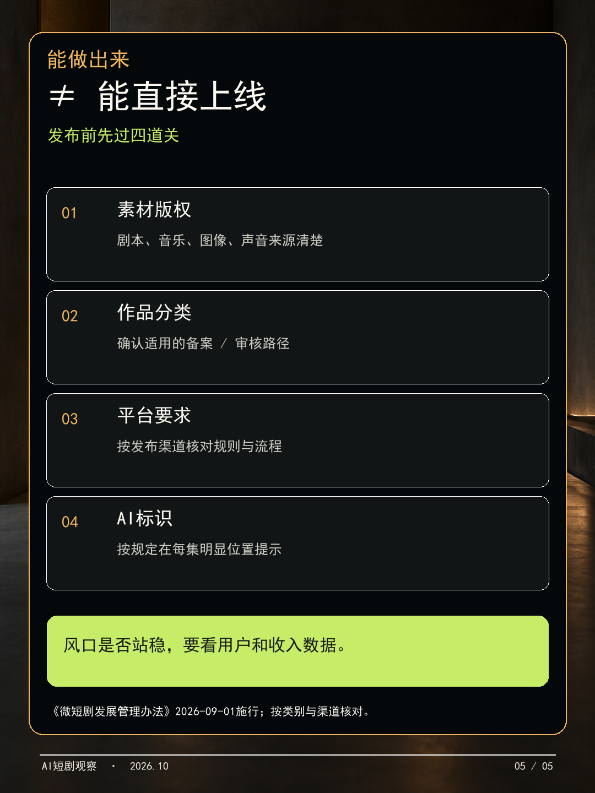

# 掌阅两次涨停后：AI短剧是风口，还是先热后验？

## 第1页｜封面

## 第2页｜先分清三本账

## 第3页｜供给在放量，商业结果要另看

## 第4页｜创作者先做小样，再决定扩不扩

## 第5页｜真正上线前，还有四道关

## 配文（复制发布）
掌阅科技10月9日和12日连续涨停，公司10月12日晚发布股票交易异常波动公告，AI短剧也因此被更多人关注。但看财报要把三件事分开：股价表现、公司“短剧等衍生业务”收入、AI短剧单项收入。掌阅2026年上半年“短剧等衍生业务”收入11.85亿元，不等于AI短剧收入；公司称报告期内共上线千余部剧集，另称多部AI短剧热播，但AI短剧具体部数和单项收入均未单独披露。行业上新数量确实很大，但作品数不等于观众认可或赚钱。对创作者来说，先做一支小样，验证故事和观众反馈，再看版权、上线审核与AI标识要求，往往比先批量生成更稳。你觉得AI短剧眼下最大的门槛是好故事、流量，还是变现？

## 线索来源（不发布）

- [中国基金报：AI漫剧概念股活跃、行业仍面临流量和变现考验](https://www.chnfund.com/article/ARf9818528-234f-6a38-8520-3a2442a262f1)，2026-10-12。用于市场板块热度和行业观察；不是掌阅收入证明。
- [证券日报经东方财富转载：掌阅科技股票异常波动](https://finance.eastmoney.com/a/202610123892851239.html)，2026-10-12。用于10月9日、12日交易异动线索。
- [中国网络视听协会：2026年第二季度微短剧行业观察](https://www.cnsa.cn/art/2026/8/13/art_1955_49173.html)，2026-08-13。用于行业供给由量转质的观察。
- [中国网络视听协会：AI短剧行业观察](https://www.cnsa.cn/art/2026/8/20/art_1955_49187.html)，2026-08-20。用于AI短剧供给与内容竞争背景。

## 事实核验来源（不发布）

- [上交所掌阅科技公司信息与公告页](https://www.sse.com.cn/assortment/stock/list/info/company/index.shtml?COMPANY_CODE=603533)，含异常波动公告条目，上交所列表列示日期为2026-10-13。
- [上交所《掌阅科技股票交易异常波动公告》](https://static.sse.com.cn/disclosure/listedinfo/announcement/c/new/2026-10-13/603533_20261013_WKKP.pdf)，公告正文落款2026-10-12；公司10月12日晚发布公告，上交所列表列示日期为10月13日。可检索的[公告全文转录](https://www.9fzt.com/detail/sh_603533_2_4845139971115.html)显示正文及落款；[证券日报经东方财富转载的报道](https://finance.eastmoney.com/a/202610123892851239.html)于10月12日晚报道该公告。
- [巨潮资讯《掌阅科技2026年半年度报告》](https://static.cninfo.com.cn/finalpage/2026-08-27/1225510832.PDF)，公告日期2026-08-27，数据截至2026-06-30；“短剧等衍生业务”收入见报告第8–10页；第9页原文称“报告期内共上线千余部剧集”，另称“多部AI短剧热播”，没有披露AI短剧具体部数，亦未单列AI短剧收入；行业Q2供给统计见第7页。
- [上交所掌阅科技公司信息页](https://www.sse.com.cn/assortment/stock/list/info/company/index.shtml?COMPANY_CODE=603533)及[新浪财经半年报全文检索页](https://vip.stock.finance.sina.com.cn/corp/view/vCB_AllBulletinDetail.php?id=12546761)，用于半年报字段交叉核对；以巨潮资讯原报告为准。
- [证券之星：掌阅科技10月9日收盘报道](https://stock.stockstar.com/RB2026100900025444.shtml)，2026-10-09；[中财网交易公开信息](https://quote.cfi.cn/cfi_lhb_stock.aspx?stockcode=603533)，用于行情数据交叉核对。仅写10月9日、12日涨停及公司10月12日晚公告，不把10月14日延迟盘中行情当作收盘价。
- [国家广播电视总局令第16号《微短剧发展管理办法》](https://www.nrta.gov.cn/art/2026/7/31/art_113_73785.html)，2026-07-31公布，2026-09-01施行。作品分类、审核/备案及AI生成内容标识要求应按具体类别和播出渠道核对。

## 配套长文

[掌阅两次涨停后：AI短剧的风口到了吗？先看清供给、收入和变现](掌阅科技AI短剧长文.md)

## 内部审核汇总

待独立审核代理逐页复核图文、图片尺寸、原始链接及口径；本稿不构成投资建议。编辑结论仅为媒介与内容产业观察：行业供给已显著放量，掌阅已披露AI短剧生产布局；但AI短剧单项收入、利润和作品表现尚未由半年报单列披露，商业验证仍需观察。
