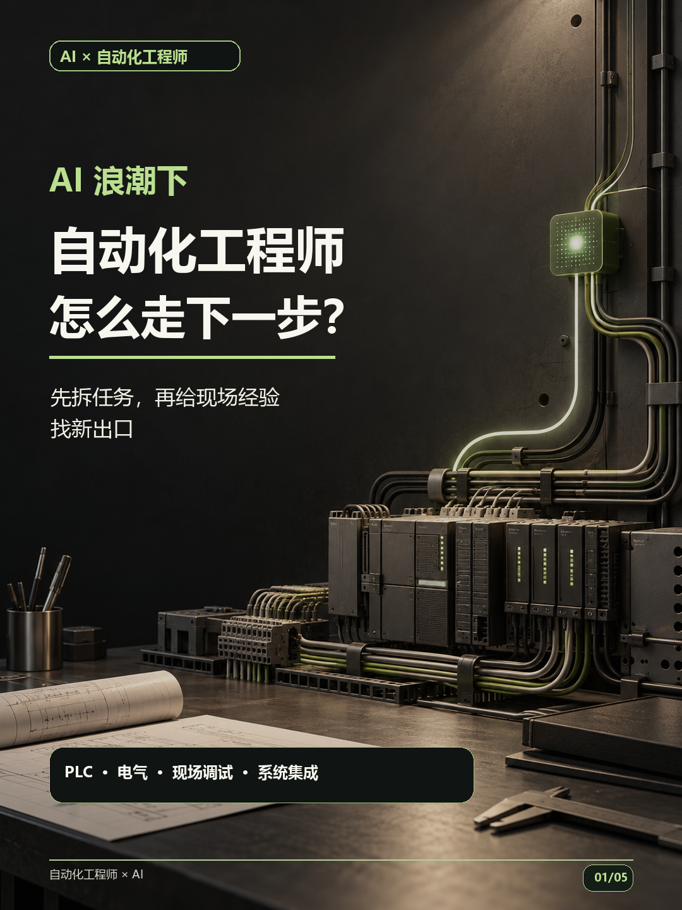
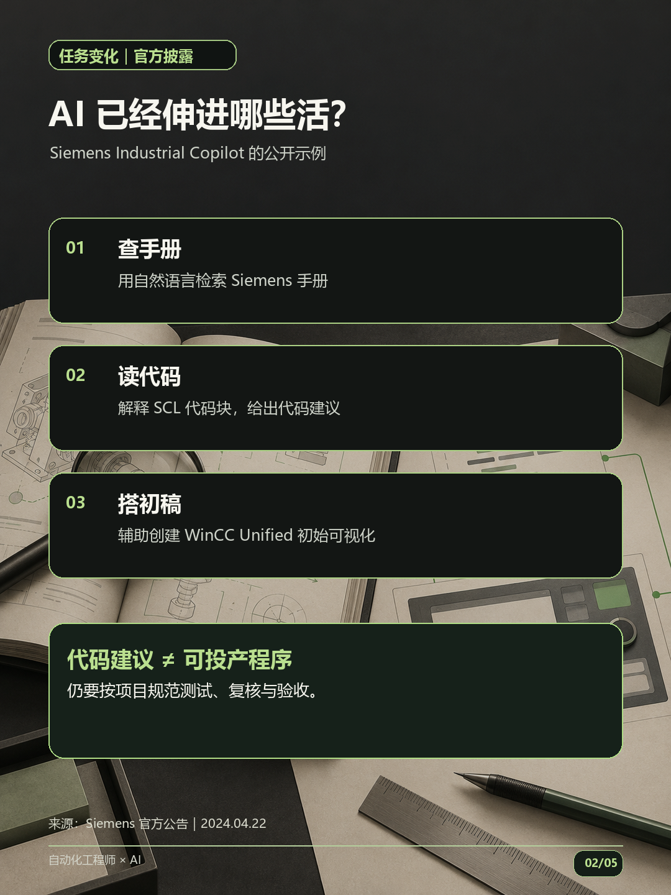
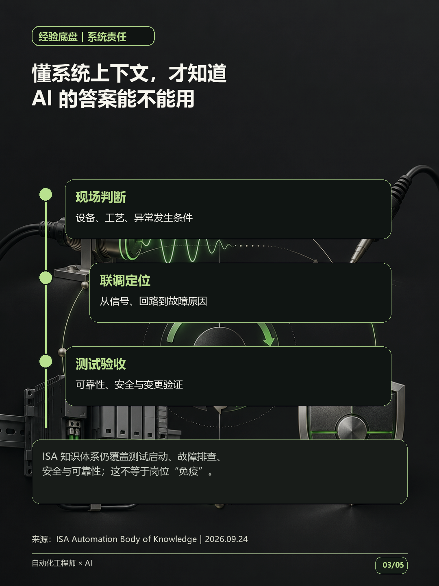
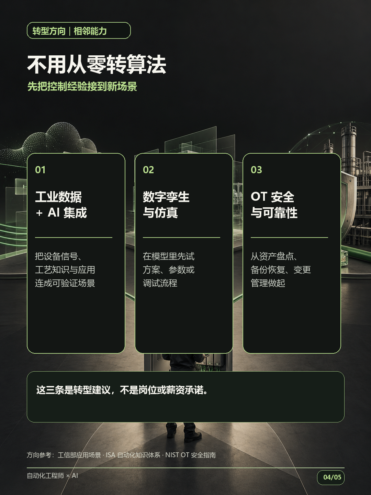
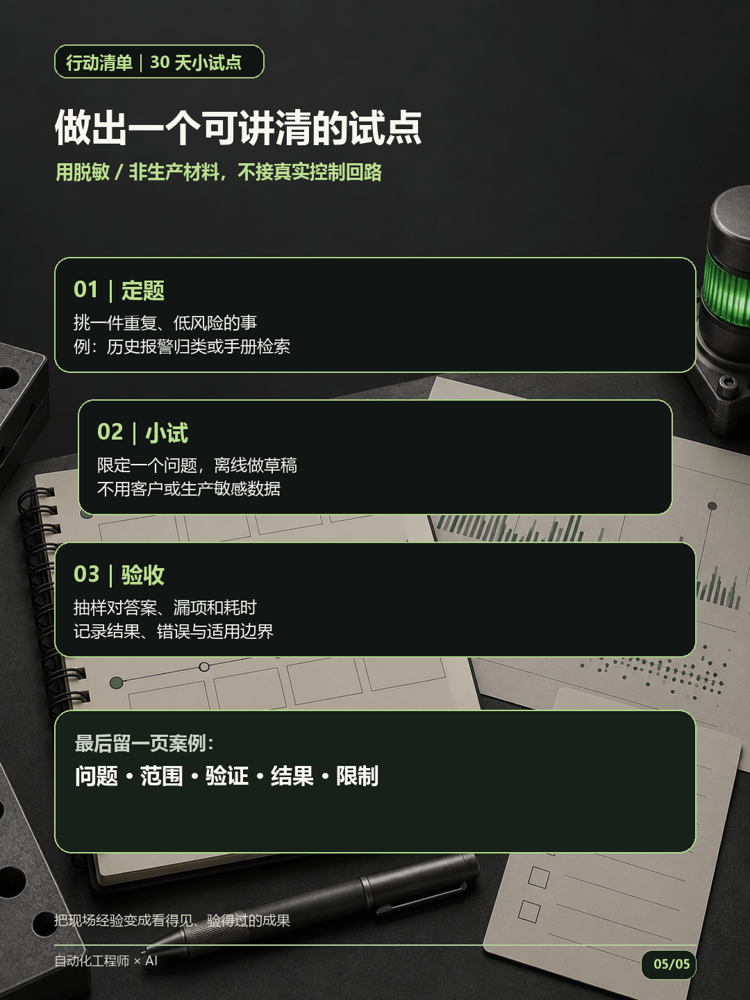

# AI浪潮下，自动化工程师如何存活和转型

> 5页短轮播｜面向 PLC、电气、控制、现场调试与系统集成人员

## 第 1 页｜封面：先拆任务，再找新出口

## 第 2 页｜AI 已经伸进哪些活？

## 第 3 页｜懂系统上下文，才知道答案能不能用

## 第 4 页｜不用从零转算法：三条相邻方向

## 第 5 页｜用 30 天做一个低风险试点

## 配文（复制发布）

如果你做 PLC、电气、控制或现场调试，先别被“AI 会取代工程师”吓住：目前更具体的变化，是 AI 开始辅助查手册、解释 SCL 代码、给代码建议和搭初始 HMI。代码建议只是建议，不等于可投产程序。更稳妥的做法，是保住控制、联调、故障定位、测试验收这条底盘，再选一条邻路：工业数据与 AI 集成、数字孪生与仿真，或 OT 安全与设备可靠性。给自己 30 天，用脱敏、非生产材料做一个小试点，记录耗时、错漏和边界，整理成一页能讲清楚的案例。方向建议不等于岗位或薪资承诺。你现在最重复的一项工作是什么？#自动化工程师 #PLC #AI转型

## 线索来源（不发布）

- 指定站访问记录留存于内部工作流。AI NewsRSS、AI联播网、AITNT、优设AI导航未找到可核实的相关具体报道；AI Product Hub 指定入口超时，只检索到相关[智能制造分类](https://aiproducthub.cn/favorites/ai-smart-manufacturing/)及一篇[待核实推荐文章](https://aiproducthub.cn/zt/49009.html)，未将其文中主张当作事实。
- 因指定资讯站缺少可核实的直接报道，本篇线索改用 Siemens Industrial Copilot 官方公告、ILO 工作论文、工信部“人工智能+制造”相关文件、ISA 自动化知识体系公告与 NIST OT 安全指南。

## 事实核验来源（不发布）

- [Siemens：Industrial Copilot 扩展至 TIA Portal Engineering 的官方公告](https://press.siemens.com/global/en/pressrelease/siemens-xcelerator-scaling-roll-out-generative-ai-siemens-industrial-copilot)｜2024-04-22。支持手册检索、SCL 代码解释/建议及 WinCC Unified 初始可视化等厂商披露能力；不支持“可无人审核生成安全可投产程序”的说法。
- [ILO：Generative AI and Jobs—A refined global index of occupational exposure](https://www.ilo.org/publications/generative-ai-and-jobs-refined-global-index-occupational-exposure)｜2025-05-20。任务暴露评估不是某个职业的失业率或裁员预测。
- [国家数据局：八部门“人工智能+制造”专项行动实施意见及附件](https://www.nda.gov.cn/sjj/zwgk/zcfb/0112/20260107214358696030895_pc.html)｜页面发布于 2026-01-09；文件落款 2025-12-25。支持制造业 AI、数据集、工业智能体和应用场景的政策方向；目标不等于已兑现岗位或招聘承诺。
- [ISA：新版 Automation Body of Knowledge 发布公告](https://www.isa.org/news-press-releases/2026/september/isa-announces-newly-updated-fourth-edition-autobok)｜2026-09-24。支持自动化知识体系仍涵盖系统测试、启动、故障排查、安全与可靠性等范围；不代表这些能力不会受 AI 影响。
- [NIST：Guide to Operational Technology (OT) Security, SP 800-82 Rev.3](https://www.nist.gov/publications/guide-operational-technology-ot-security)｜2023-09-28。用于说明 OT 系统涉及物理过程，并有性能、可靠性与安全约束；这是美国技术指南，不是中国强制法规。

## 长文

想看完整背景、三条路径分析和 30 天行动拆解，见[《自动化工程师AI转型长文》](自动化工程师AI转型长文.md)。

## 内部审核汇总

编辑交付版本：5 页；页面事实与对应来源已分开标注；轮播不把任务暴露写成失业率，不把厂商代码建议写成可直接上产线的安全程序，不承诺转型后的岗位或收入。待独立审核代理逐页核验图文、来源与事实。
