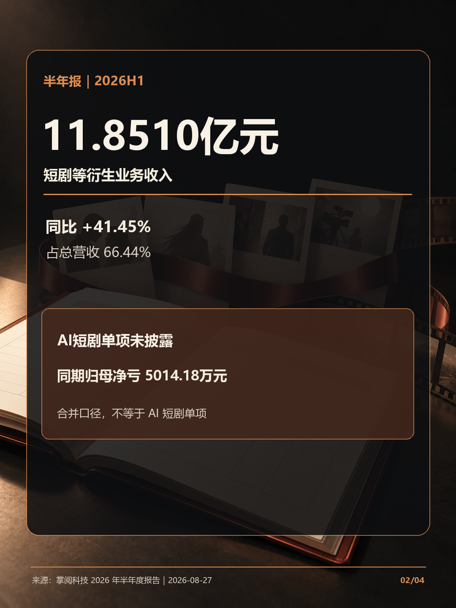
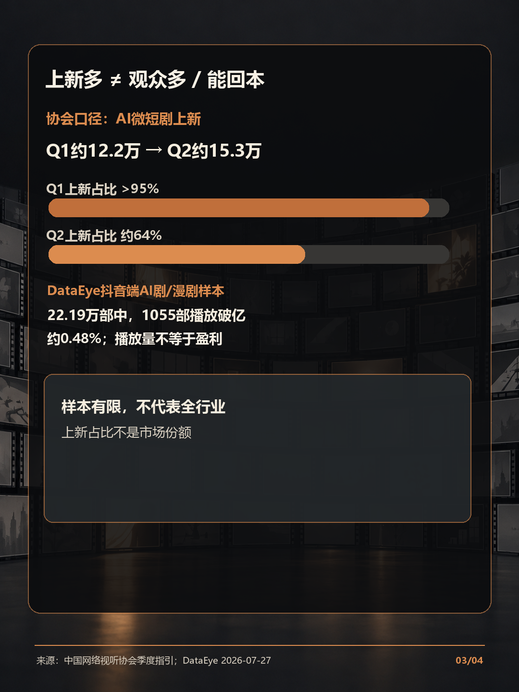

# 掌阅涨停，AI短剧已是风口吗？

## 配文（复制发布）

掌阅10月14日收盘涨停，但这不能证明上涨由AI短剧驱动。半年报的11.851亿元是“短剧等衍生业务”合并收入，AI短剧单项未披露，公司同期仍净亏。行业上新多，也不等于有人看或能回本。普通创作者可先做小样看反馈，再核授权、平台规则与AI标识，确认有观众再扩大投入。数据截至10月14日收盘；本文不是投资建议。

## 线索来源（不发布）

指定聚合站未找到可直接支持掌阅涨停或AI短剧经营数据的具体报道；AI NewsRSS、AI Product Hub、AITNT、AI联播网和优设AI导航的访问情况及检索记录留存于内部工作流。公开可用的延伸线索：[掌阅科技半年报](https://static.cninfo.com.cn/finalpage/2026-08-27/1225510832.PDF)、[中国网络视听协会季度指引](https://www.cnsa.cn/art/2026/8/13/art_1955_49173.html)、[新华社/中国青年报 Q2 行业报道](https://www.xinhuanet.com/ent/20260915/ff443c1eed934993a0c9f8787122a31d/c.html)、[DataEye 数据报告摘要](https://m.thepaper.cn/newsDetail_forward_33665132)。

## 事实核验来源（不发布）

- 行情交叉核验：[英为财情历史行情](https://cn.investing.com/equities/ireader-tech-historical-data)、[证券之星 10 月 14 日收盘报道](https://stock.stockstar.com/RB2026101400027298.shtml)。行情不能证明上涨原因。
- 公司口径：[掌阅科技 2026 年半年度报告](https://static.cninfo.com.cn/finalpage/2026-08-27/1225510832.PDF)，未经审计；“短剧等衍生业务”未单列 AI 短剧收入。
- 行业上新：[中国网络视听协会 Q1 数据](https://www.cnsa.cn/art/2026/8/13/art_1955_49173.html)、[新华社/中国青年报 Q2 报道](https://www.xinhuanet.com/ent/20260915/ff443c1eed934993a0c9f8787122a31d/c.html)。上新量不代表用户需求或收入。
- 样本边界：[DataEye 研究报告摘要](https://m.thepaper.cn/newsDetail_forward_33665132)。0.48%表示报告所述抖音端样本中播放量破亿比例，不是盈利率。
- 逐集提示义务依据：[国家广电总局《微短剧发展管理办法》](https://www.nrta.gov.cn/art/2026/7/31/art_113_73785.html)，对AI生成、制作的微短剧规定制作机构、播出单位按规定逐集添加提示标识。
- 发布者声明与平台标识依据：[人工智能生成合成内容标识办法](https://www.cac.gov.cn/2025-03/14/c_1743654684782215.htm)，规定用户发布生成合成内容时应主动声明并使用服务提供者标识功能。

## 长文

[阅读《掌阅科技AI短剧长文》](掌阅科技AI短剧长文.md)

---

内部审核汇总：4 页 PNG 均为原创概念视觉叠加准确中文排版；尺寸 1080×1440（3:4）。内容区分股价表现、公司合并业务口径与行业供给样本，不把播放量当盈利率；长文和来源链接见同目录文件。
